# Ultra-high-innovation model, why not try 3DCNN fault diagnosis! MATLAB code

This issue introduces a method for bearing fault diagnosis based on multi-resolution mel analysis, which is as follows:
The approach involves utilizing Melspectrogram analysis to convert one-dimensional fault data into three-dimensional data (how this is achieved is not disclosed here!). This processed data is then fed into the training and testing of a 3DCNN model. The experiments were conducted on bearing data from Xichu University and gearbox data from Southeast University, achieving a 100% accuracy rate in both cases.
To make the article less monotonous, we also integrated the classic network of 3DCNN-SVM, which you can choose to use or not.
This method is uniquely created by Tao's code, so do not ask about it; just know that no one has used it before!
For those still pondering over innovative ideas, take a look now!
The code implemented in this issue includes:
①Processing of data from Xichu University and Southeast University gearboxes
②Conversion of one-dimensional data using Melspectrogram analysis to three-dimensional data
③Training with 3DCNN
④TSEN dimensionality reduction analysis and visualization of results
⑤Training and prediction with 3DCNN-SVM
The model structure diagram is as follows (in Visio format):
\n        \n      \n        \n      Content detailed explanation
I. Data Processing
①Process the official downloaded data from Xichu University, following these steps:
Load a total of 10 types of data, then select DE_time (%DE is the drive end data, FE is the fan end data, BA is the acceleration data, choose one of them) for each data.
Set the sliding window w, the number of sample points s for each fault type, and the sample quantity m for each fault type.
After all the data are slid through the window, combine them into a single data variable.
Regarding the processing of Xichu University bearing data, there was an article previously mentioned, which you can refer to: Xichu University Bearing Diagnosis Data Processing, MATLAB Free Code Acquired.
The final data is a 1000*2048 matrix, where 1000 is the sample size and 2048 is the number of features. The 1000 also equals to 100*10, indicating that there are 10 types of fault states, with each state having 100 samples. In the code, it is stored as data_total_1797.mat.
Step two: Process the official downloaded data from Southeast University. Here are the steps:
- Load five types of gearbox data, including five types of fault data under the condition of 20Hz (1200rpm) - load 0V (0Nm):
   - Chipped tooth (Cracked tooth on gear, with cracks on the gear)
   - Healthy working state (Normal working state)
   - Missing tooth (Broken tooth)
   - Fault at the root of the gear (Root fault)
   - Surface fault (Surface fault)
- Set the sliding window w, each data's fault sample points s, each type of fault sample quantity m
- After all the data is slid through the window, combine them into one variable called data
- Finally, the data is a 1000*2048 matrix, where 1000 is the sample size, each fault has taken 200 samples, and 2048 is the number of features. The 1000 also equals to 200*5, which means there are 5 types of fault states, with each state having 200 samples. In the code, it is stored as data_total.mat.
Step three: Conduct Mel Frequency Spectrum Transformation
The transformed data is a series of 3D data, with the first row being the original data itself and the second row being the label column.
Step four: Results Display
Results of bearing data diagnosis from XiuYun University (the first 70 samples in each group are used for training, and the last 30 are used for testing):
\n        \n      \n        \n      \n        \n      \n        \n      Data diagnosis results of gearbox from Southeast University (the first 140 samples in each group are used for training, and the last 60 for testing):
\n        \n  
\n        \n      \n        \n      Each folder contains a '.txt' file with explanations. Please carefully read them before running the program to better understand its functionality. Follow the steps one by one.
\n        \n      Documentation:
\n        \n  
Specific references:
\nMulti-resolution short-time Fourier transform providing deep features for 3D CNN to classify rolling bearing fault vibration signals

## Images

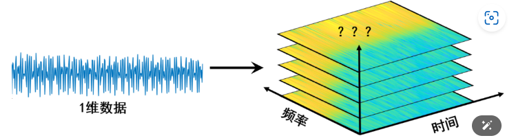
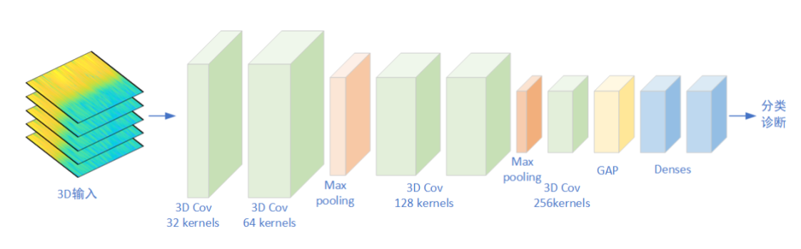
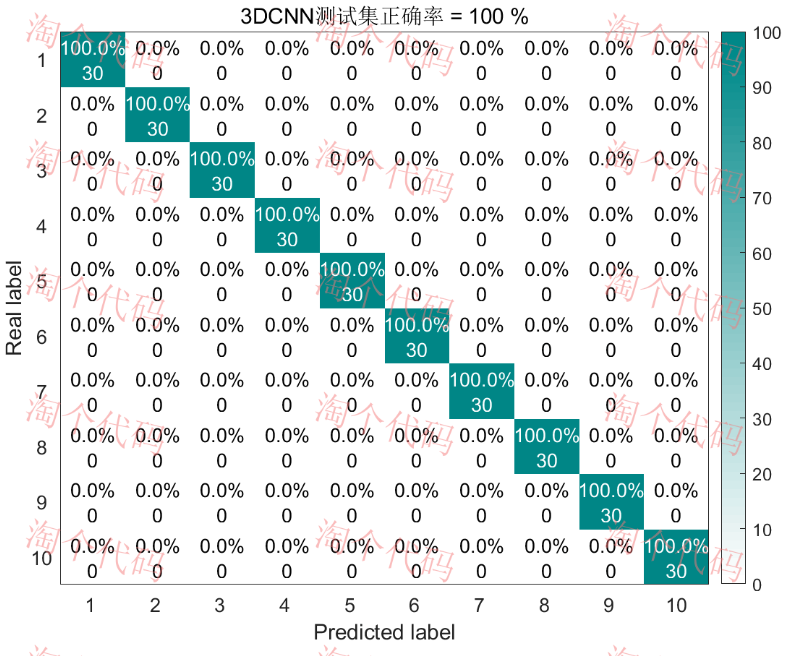
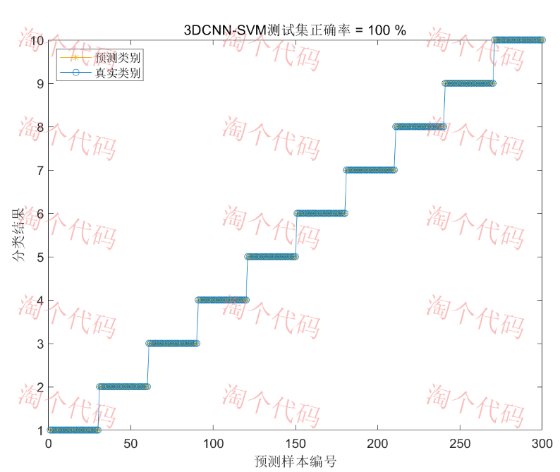
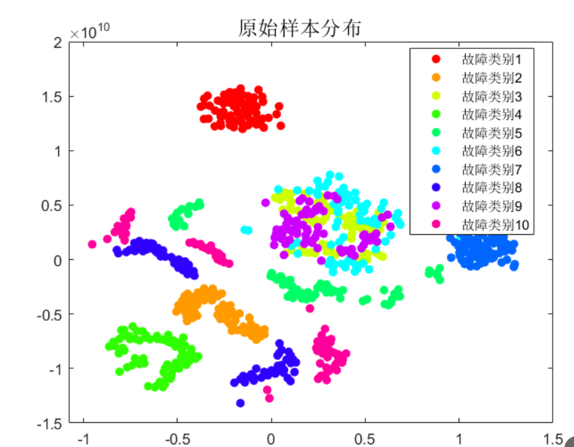
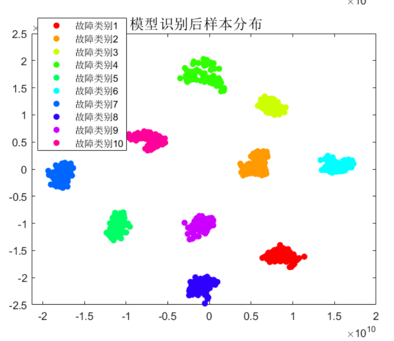
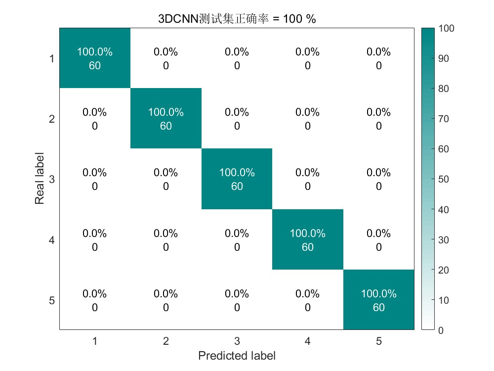
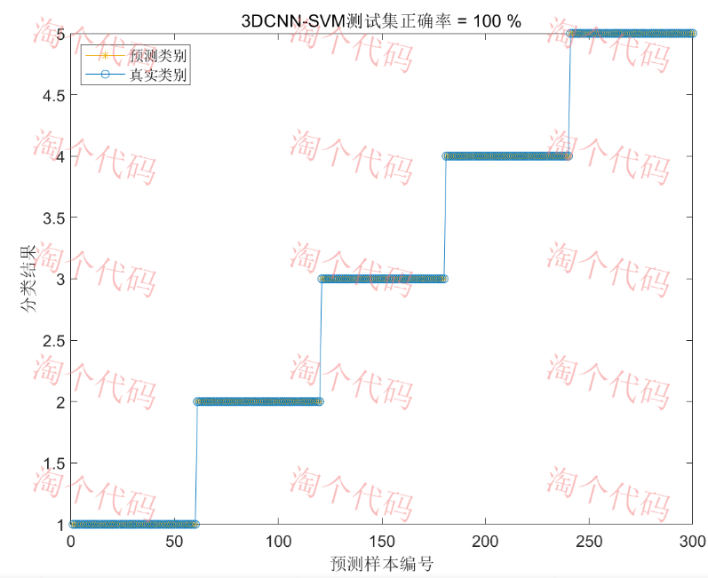
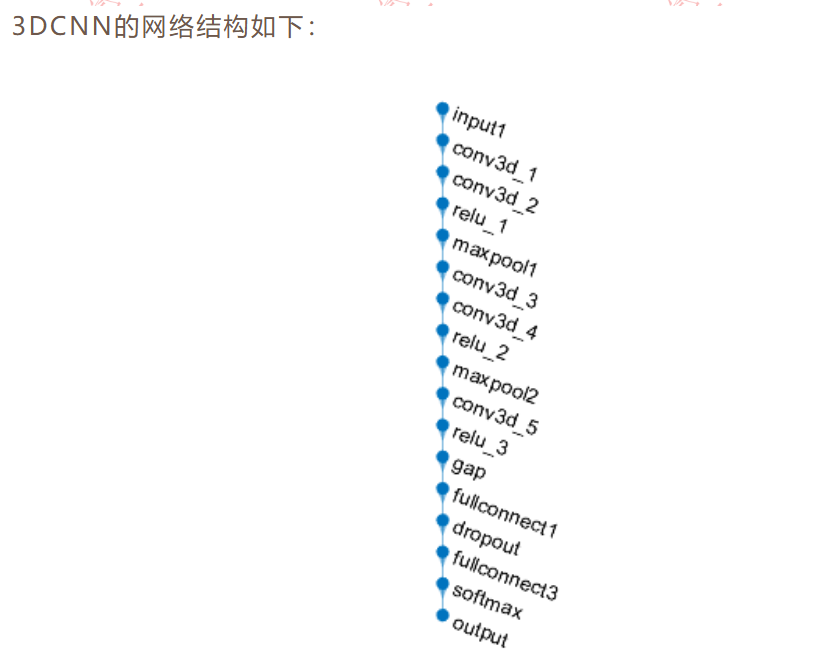
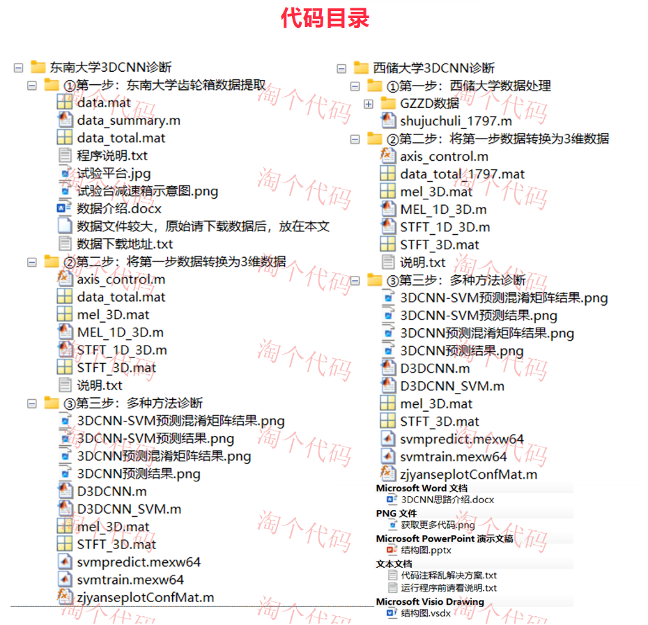
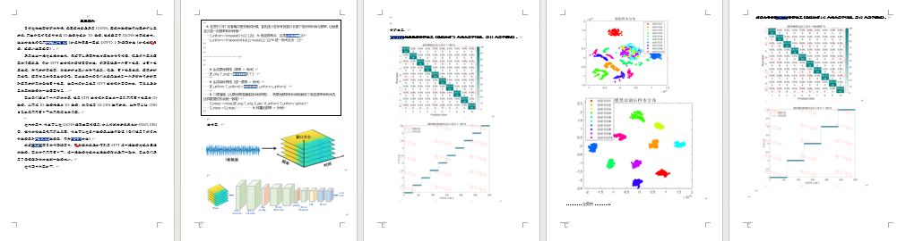

<!-- PAYMENT_BLOCK -->

## Get this dataset

- Payment link (Stripe): [Buy now](https://buy.stripe.com/3cs8yP7sY87d0vu9AB)
- Payment QR code: 

<!-- /PAYMENT_BLOCK -->
